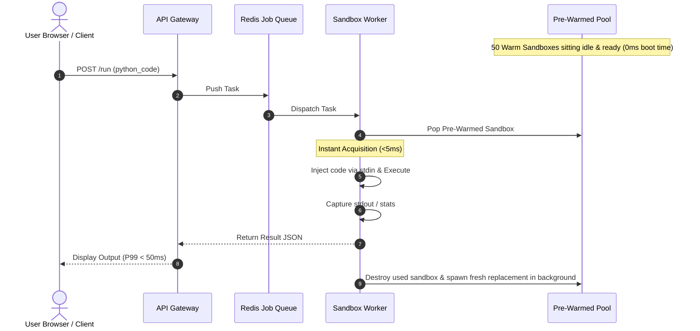

# System Design: Remote Code Execution Engine & Sandbox (LeetCode / Replit / AI Code Interpreter)

A friendly, step-by-step breakdown of how modern platforms like **LeetCode, Replit, HackerRank and ChatGPT Code Interpreter** safely run untrusted user code in milliseconds without getting hacked, crashed or drained of server resources.

---

## 1. What is a Remote Code Execution Engine?

Imagine you build a website where users can type Python or JavaScript into a text box, click **"Run"** and see the output in real-time.

```text
  [ User Browser / AI Agent ]
             │
             │  POST /api/execute { code: "print('Hello World')", lang: "python" }
             ▼
  [ Your Backend Server ]  ──▶  Runs the code  ──▶  Returns "Hello World"
```

Sounds simple at first! In Python, couldn't you just do `exec(user_code)`?

**Absolutely not! That would be suicide for your server.** 

If anyone submits:
```python
import os
os.system("rm -rf /") # Deletes everything on your hard drive!
```
...your entire server is wiped out within seconds.

A **Remote Code Execution (RCE) Engine** is an isolated computing system that accepts unknown, potentially malicious code from total strangers on the internet, runs it in an airtight digital "quarantine box" (a sandbox), captures its printed output and destroys the box—all in under 50 milliseconds.

---

## 2. Why Is This Problem So Hard? (The 5 Nightmare Scenarios)

When you let strangers run code on your computers, they will (accidentally or intentionally) try to destroy your system:

| Attack / Mistake | Example Code | What Happens Without Protection |
| :--- | :--- | :--- |
| **1. The Fork Bomb** | `:(){ :|:& };:` (Bash) or recursive process spawn | Spawns millions of processes, exhausting OS Process IDs (PIDs) and completely freezing the host machine. |
| **2. The Memory Hog** | `a = [0] * (10**10)` | Allocates 80 GB of RAM in 1 second, triggering Linux Out-Of-Memory (OOM) killer to crash all other services. |
| **3. The Infinite Loop** | `while True: pass` | Burns 100% of a CPU core forever, driving cloud hosting bills through the roof and starving other users. |
| **4. Cloud Credential Theft** | `requests.get("http://169.254.169.254/latest/meta-data/")` | Reaches internal AWS/GCP metadata endpoints and steals your cloud secret keys and database passwords. |
| **5. Disk Fill-up Bomb** | `with open('big', 'w') as f: f.write('0'*10**12)` | Fills the server's hard drive to 100%, causing databases and OS logging to halt immediately. |

---

## 3. Requirements

### Functional Requirements (What It Must Do)
1. **Execute Multi-Language Code:** Run user code (Python, JavaScript, Go, C++, etc.) with custom input (`stdin`).
2. **Capture Outputs:** Return standard output (`stdout`), standard error (`stderr`), exit codes, execution duration and peak memory used.
3. **Enforce Hard Limits:** Automatically kill any process that exceeds execution time (e.g., 5 seconds) or memory (e.g., 256 MB).
4. **Clean Reset:** Every single execution starts with a virgin, clean environment. No state or files leak from User A to User B.
5. **Real-Time Streaming (Optional for Interactive IDEs):** Stream terminal output line-by-line via WebSockets.

### Non-Functional Requirements (How Well It Must Perform)
* **Extreme Isolation (Security):** Zero escape from the sandbox to the host OS. Zero access to host filesystem, network, or sibling containers.
* **Blazing Fast Latency:** Total execution overhead (excluding user code execution time) must be **< 50ms**. Users should not wait seconds just for a container to boot!
* **High Throughput:** Handle thousands of concurrent code submissions simultaneously during contests or peak hours.
* **Cost Efficiency:** Sandbox environments must be recycled quickly without burning idle cloud CPU/RAM.

---

## 4. The 4 Layers of Defense (The "Airtight Quarantine Box")

To protect the server, we use native Linux kernel security features layered like an onion:

```
┌─────────────────────────────────────────────────────────────┐
│                       Host Machine                          │
│                                                             │
│   ┌─────────────────────────────────────────────────────┐   │
│   │               MicroVM / Sandbox Jail                │   │
│   │                                                     │   │
│   │   1. Namespaces (Blindfold):                        │   │
│   │      Can only see its own virtual PID & Mount       │   │
│   │                                                     │   │
│   │   2. cgroups v2 (Handcuffs):                        │   │
│   │      Max 256MB RAM, Max 1 CPU core, Max 20 PIDs     │   │
│   │                                                     │   │
│   │   3. Seccomp Bouncer (Restricted Syscalls):         │   │
│   │      Blocks socket(), reboot(), ptrace(), mount()   │   │
│   │                                                     │   │
│   │   4. Read-Only Root Filesystem:                     │   │
│   │      Cannot write or modify system files            │   │
│   │                                                     │   │
│   │               [ User Untrusted Code ]               │   │
│   └─────────────────────────────────────────────────────┘   │
└─────────────────────────────────────────────────────────────┘
```

### Layer 1: Linux Namespaces ("The Blindfold")
Namespaces make the running process believe it is the only program on the computer.
* **PID Namespace:** Process ID `1` belongs to the user script. It cannot see or kill any host process.
* **Mount Namespace:** Gives the process a tiny, isolated root directory. Host folders (`/etc/`, `/home/`, `/var/`) are invisible.
* **Network Namespace:** Disconnected by default (`lo` loopback only). The script cannot access the internet or local AWS VPC network.

### Layer 2: Linux Control Groups / cgroups v2 ("The Handcuffs")
cgroups strictly meter and enforce hardware resources:
* `memory.max = 268435456` (exactly 256 MB). If exceeded, Linux instantly triggers a SIGKILL (OOM error).
* `cpu.max = "100000 100000"` (strictly caps CPU to 1 core max).
* `pids.max = 30` (prevents fork bombs from creating more than 30 processes).

### Layer 3: Seccomp Filters ("The Bouncer")
Even with restricted memory, programs can invoke system calls (`syscalls`) to communicate directly with the Linux kernel. Seccomp blocks dangerous syscalls:
* Allowed: `read`, `write`, `exit`, `mmap`, `brk` (basic computing).
* Blocked / Killed: `reboot`, `sys_chroot`, `ptrace` (debugger hijacking), `init_module` (loading kernel drivers), `socket` (network).

### Layer 4: MicroVMs (Firecracker / gVisor)
Regular Docker containers share the exact same Linux kernel with the host machine. If there is a kernel zero-day vulnerability (like *Dirty COW*), a hacker can escape Docker!
* Platforms like **AWS Lambda, Fly.io and Replit** use **Firecracker MicroVMs**: ultra-minimalist virtual machines that launch in **5 milliseconds** with their own independent, locked-down guest kernel.

---

## 5. The "Latency Trap": Cold Starts vs The Warm Pool Pattern

### The Problem:
If a user submits code and you start a brand-new container from scratch:
1. Docker image pull / unpack: ~3,000ms
2. Container boot: ~1,500ms
3. Python runtime start: ~200ms
4. User code `print(2+2)`: ~10ms
* **Total Wait Time:** ~4.7 seconds! ❌ (Users will close your website in frustration).

### The Solution: The "Warm Sandbox Pool" Pattern
Instead of creating a sandbox on demand, we **pre-warm** hundreds of ready-to-run sandboxes in memory ahead of time!



1. **Pre-fork / Warm:** 50 clean sandboxes are constantly running in the background, waiting for work.
2. **Instant Claim:** When a request arrives, the worker grabs a warm container from the pool instantly (< 3ms).
3. **Execution:** Code is piped into the container, executed and outputs are gathered.
4. **Nuke & Replace:** The used sandbox is **instantly destroyed** (to prevent any state pollution) and a background thread spins up a new warm container to refill the pool.

---

## 6. High-Level System Architecture

```text
               ┌──────────────────────────────┐
               │         Client App           │
               │   (LeetCode UI / AI Agent)   │
               └──────────────┬───────────────┘
                              │ HTTPS / WebSocket
                              ▼
               ┌──────────────────────────────┐
               │    API Gateway & Auth        │
               │   (Rate Limiter / WAF)       │
               └──────────────┬───────────────┘
                              │
                              ▼
               ┌──────────────────────────────┐
               │      Task Broker & Queue     │
               │  (Redis Streams / RabbitMQ)  │
               └──────┬────────────────┬──────┘
                      │                │
        Worker Node 1 │                │ Worker Node 2
                      ▼                ▼
     ┌────────────────────────┐  ┌────────────────────────┐
     │ Sandbox Worker Daemon  │  │ Sandbox Worker Daemon  │
     │                        │  │                        │
     │  ┌──────────────────┐  │  │  ┌──────────────────┐  │
     │  │ Warm Pool (x20)  │  │  │  │ Warm Pool (x20)  │  │
     │  │ [Box] [Box] [Box]│  │  │  │ [Box] [Box] [Box]│  │
     │  └─────────┬────────┘  │  │  └─────────┬────────┘  │
     │            ▼           │  │            ▼           │
     │   [Active Execution]   │  │   [Active Execution]   │
     │     - cgroups limit    │  │     - cgroups limit    │
     │     - seccomp filter   │  │     - seccomp filter   │
     │     - watchdog timer   │  │     - watchdog timer   │
     └────────────────────────┘  └────────────────────────┘
```

### Component Breakdown
1. **API Gateway:** Validates code payload size (max 64 KB), checks user rate limits and strips obvious malware signatures.
2. **Task Queue (Redis Streams):** Buffers incoming submissions so worker nodes never get overwhelmed during traffic surges.
3. **Worker Daemon:** Manages the lifecycle of sandboxes on physical Linux worker instances.
4. **Watchdog Timer:** A native OS process monitor. If user code takes more than 2.0 seconds, the watchdog sends an uncatchable `SIGKILL` (-9) to the process.

---

## 7. Scale & Capacity Estimation

Let's size a platform handling **10 Million code submissions per day** (comparable to peak LeetCode / competitive programming contests).

### 7.1 Throughput (QPS)
* **Submissions per day:** $10,000,000$
* **Average QPS:** $\frac{10,000,000}{86,400} \approx 116 \text{ executions / second}$
* **Peak Traffic (Contest Start - 10x surge):** $116 \times 10 \approx \mathbf{1,200 \text{ QPS}}$

### 7.2 Compute & Memory Sizing
* **Max Execution Time limit:** 2.0 seconds
* **Average Execution Time:** ~200 milliseconds (0.2s)
* **Concurrent running sandboxes at peak:**
  $$\text{Concurrency} = 1,200 \text{ QPS} \times 0.2 \text{ seconds} = \mathbf{240 \text{ active sandboxes}}$$
* **Memory per sandbox:** Capped at $256 \text{ MB}$.
  * $240 \text{ active} \times 256 \text{ MB} = \mathbf{61.4 \text{ GB RAM}}$ across the entire cluster!
* **Warm Pool Buffer:**
  * Keep 20 warm sandboxes per worker node across 15 worker machines = 300 warm sandboxes (~76 GB RAM).
  * **Result:** A modest cluster of **15 standard 4-vCPU / 16GB RAM cloud instances** easily handles 10 Million executions a day!

---

## 8. Directory Structure of this Module

This folder contains a complete reference implementation and deep-dive documentation:

```text
system-design-code-execution-engine/
├── README.md                              # This primary overview guide
├── LICENSE                                # MIT License
├── docs/
│   ├── architecture.md                    # Deep dive into components and worker flow
│   ├── isolation_sandboxing.md            # Namespaces, cgroups, seccomp & Firecracker vs Docker
│   ├── warm_pool_lifecycle.md             # How warm pool pre-forking achieves <30ms latency
│   ├── security_and_threat_model.md       # The 6 attack vectors and how to neutralize each
│   └── api_design.md                      # REST and WebSocket streaming specifications
└── examples/
    ├── sandbox_runner_demo.py             # Runnable Python script simulating secure execution
    └── sample_execution_request.json      # Sample input/output JSON schemas
```

---

## 9. Summary Cheat Sheet for System Design Interviews

If asked to design LeetCode or a Code Execution Engine in an interview, remember these 4 pillars:

1. **Never use `eval()` or bare `exec()`:** Always isolate at the OS kernel level using Linux Namespaces, cgroups v2 and Seccomp.
2. **Solve latency with Warm Pools:** Pre-spin containers or use memory snapshots so cold start is eliminated.
3. **Hard enforcement of limits:** Kill memory hogs via cgroup OOM and infinite loops via watchdog timers (`SIGKILL`).
4. **Airgap the network:** Isolate the sandbox's network namespace (`--net=none`) so malicious scripts cannot steal cloud tokens or scan internal networks.

---

## License

This project is licensed under the MIT License. See [LICENSE](LICENSE) for details.

