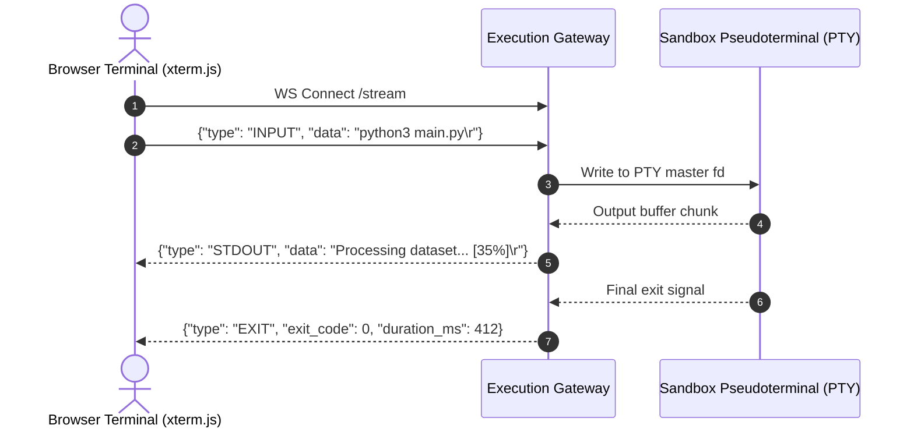

# API Design & Data Contracts

Specifications for the Remote Code Execution Engine: synchronous execution, asynchronous batch grading and real-time terminal streaming.

---

## 1. Synchronous Code Execution (LeetCode Style)

Used when a single script with input is executed and the user expects an immediate response.

### Endpoint: `POST /api/v1/execute`

#### Request Payload:
```json
{
  "language": "python",
  "version": "3.12",
  "code": "def two_sum(nums, target):\n    seen = {}\n    for i, n in enumerate(nums):\n        if target - n in seen:\n            return [seen[target - n], i]\n        seen[n] = i\n\nimport json, sys\nnums = json.loads(sys.stdin.readline())\ntarget = int(sys.stdin.readline())\nprint(json.dumps(two_sum(nums, target)))",
  "stdin": "[2, 7, 11, 15]\n9\n",
  "limits": {
    "timeout_ms": 2000,
    "memory_limit_mb": 256
  }
}
```

#### Success Response (`200 OK`):
```json
{
  "status": "SUCCESS",
  "exit_code": 0,
  "stdout": "[0, 1]\n",
  "stderr": "",
  "execution_time_ms": 38,
  "memory_used_kb": 14280,
  "sandbox_id": "sbx-warm-042"
}
```

#### Timeout / Resource Exceeded Response (`200 OK`):
```json
{
  "status": "TIME_LIMIT_EXCEEDED",
  "exit_code": 137,
  "stdout": "",
  "stderr": "Error: Execution exceeded the time limit of 2000ms and was terminated.",
  "execution_time_ms": 2001,
  "memory_used_kb": 18200,
  "sandbox_id": "sbx-warm-088"
}
```

---

## 2. Real-Time Terminal Streaming (Replit / Interactive Style)

Used for interactive terminals and AI coding agents where output streams character-by-character.

### Endpoint: `GET /api/v1/stream?session_id=sess_99482`
**Protocol:** WebSocket (`ws://` / `wss://`)


